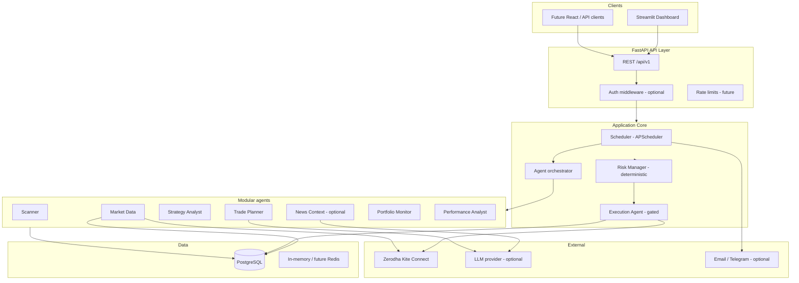

# Tradex — Architecture (Phase 1)

## Purpose

Tradex is an AI-assisted **Indian NSE cash-equity** research and trading workflow platform. It prioritizes **explainability**, **deterministic risk controls**, and **human approval** before any live order. It does **not** guarantee returns; strategies are hypotheses to backtest and paper-trade first.

## Design principles

| Principle | Implementation |
|-----------|----------------|
| Safety by default | Recommendations → paper → human-approved live; auto-execution off by default |
| Deterministic core | Indicators, signals, sizing, and gates are code—not LLM output |
| Untrusted inputs | News, web, and LLM text never trigger trades without schema validation and gates |
| Broker truth | Positions and orders reconciled against broker state before new live orders |
| No secret leakage | API keys in env; session tokens in encrypted/volatile store (future); never in LLM prompts |
| UTC storage | All DB timestamps UTC; `Asia/Kolkata` for session calendars and UI |

## High-level topology



## Repository layout (target)

```
.
├── docs/                    # Architecture, threat model, runbooks
├── src/tradex/              # Application package
│   ├── api/                 # FastAPI routers
│   ├── config/              # Pydantic settings
│   ├── db/                  # Session, base
│   ├── models/              # SQLAlchemy ORM
│   ├── brokers/             # Kite + mock adapters (Phase 6+)
│   ├── agents/              # Agent modules (Phase 3+)
│   ├── strategy/            # Indicators, signals (Phase 3+)
│   ├── risk/                # Sizing, limits (Phase 3+)
│   └── services/            # Domain services
├── alembic/                 # Migrations
├── tests/                   # pytest
├── docker-compose.yml       # Local PostgreSQL
└── .github/workflows/       # CI
```

## Agent workflow (logical)

1. **Market Data Agent** — Fetch/validate candles; flag stale or missing bars.
2. **Scanner Agent** — Universe filter (NSE cash, liquidity); rule-based candidates.
3. **Strategy Analyst** — MA trend, RSI, volume, volatility, regime (configurable).
4. **News Context Agent** (optional) — Licensed feeds only; cited timestamps; LLM summarizes; no trade triggers.
5. **Risk Manager** — Position size, exposure, daily loss, kill switch (pure Python).
6. **Trade Planner** — Proposed trade JSON + human-readable reasons; Pydantic schema.
7. **Execution Agent** — Off by default; idempotency key, compliance checklist, human token for live.
8. **Portfolio Monitor** — Reconcile DB vs broker.
9. **Performance Analyst** — Returns, drawdown, fees, slippage assumptions.

Orchestration will use explicit pipelines (no open-ended “agent loops” with trade tools).

## API surface (incremental)

| Phase | Endpoints |
|-------|-----------|
| 2 | `GET /health`, `GET /api/v1/health` |
| 3+ | Scanner, signals, settings |
| 4+ | Backtest, paper orders |
| 5+ | Dashboard backing APIs, scheduler status |
| 6+ | Kite login (OAuth), read-only portfolio/quotes |
| 7+ | Live order propose → confirm → submit |

Streamlit (Phase 5) calls the same REST API to allow a future React UI.

## Database (normalized)

See Alembic migration `001_initial_schema` for DDL. Core entities:

- **instruments** — NSE symbols, ISIN, lot size, segment.
- **candles** — OHLCV, interval, source, unique (instrument, time, interval).
- **strategy_runs** — Version, parameters JSON, started/completed.
- **signals** — BUY/HOLD/SELL, strength, idempotency key, run FK.
- **signal_explanations** — Structured reasons + optional LLM narrative (separate table).
- **paper_orders / live_orders** — State machine, idempotency, broker order id.
- **fills** — Fees, slippage fields, link to orders.
- **positions** — Local view; reconciled flag.
- **portfolio_snapshots** — EOD marks.
- **risk_events** — Limit breaches, kill switch activations.
- **audit_events** — Append-only security and trading audit.
- **app_settings** — Key/value with schema version.

## Zerodha Kite Connect (planned)

- Official `kiteconnect` Python SDK; OAuth request token → access token exchange server-side.
- **Never** store password, PIN, TOTP seed, or raw session in repo.
- Session expiry documented in README; user re-authenticates via Kite login URL.
- **Mock broker** for dev/CI; no assumption of exchange sandbox.
- Before live orders: verify Kite pricing, static IP (if required), SEBI/broker rules, and account permissions.

## Scheduling

- Market-calendar-aware jobs (NSE holidays); pre-open checks, intraday scan (configurable), EOD reconcile.
- Jobs are idempotent; respect `KILL_SWITCH`, `STALE_DATA_MAX_AGE`, and market hours.
- No job bypasses execution gates.

## Configuration

All settings via environment variables validated by `pydantic-settings`. Feature flags:

- `LLM_ENABLED=false`
- `LIVE_TRADING_ENABLED=false`
- `AUTO_EXECUTION_ENABLED=false`
- `BROKER_ADAPTER=mock`

## Phase roadmap mapping

| Phase | Deliverable |
|-------|-------------|
| 1 | This document + threat model |
| 2 | Scaffold, schema, health, CI skeleton |
| 3 | Mock data, scanner, deterministic signals |
| 4 | Backtest + paper trading |
| 5 | Streamlit + scheduler + notifications |
| 6 | Kite read-only |
| 7 | Human-approved live orders |
| 8 | Hardening, runbook, full test matrix |

## Assumptions and defaults

- Python **3.12** (tested on 3.12.10).
- PostgreSQL 15+ (Neon or Docker Compose).
- Docker not required for unit tests; integration tests skip if `DATABASE_URL` unreachable.
- Initial candle interval: **daily**; intraday later.
- Universe: NSE equity cash; no F&O, no short, no leverage in MVP.
- Single-tenant deployment first; multi-user auth scaffolded via `AUTH_ENABLED`.

## Non-goals (MVP)

- Guaranteed execution at stop-loss prices.
- Tick data warehouse.
- Unlicensed news scraping.
- Sending account identifiers to LLM providers.
